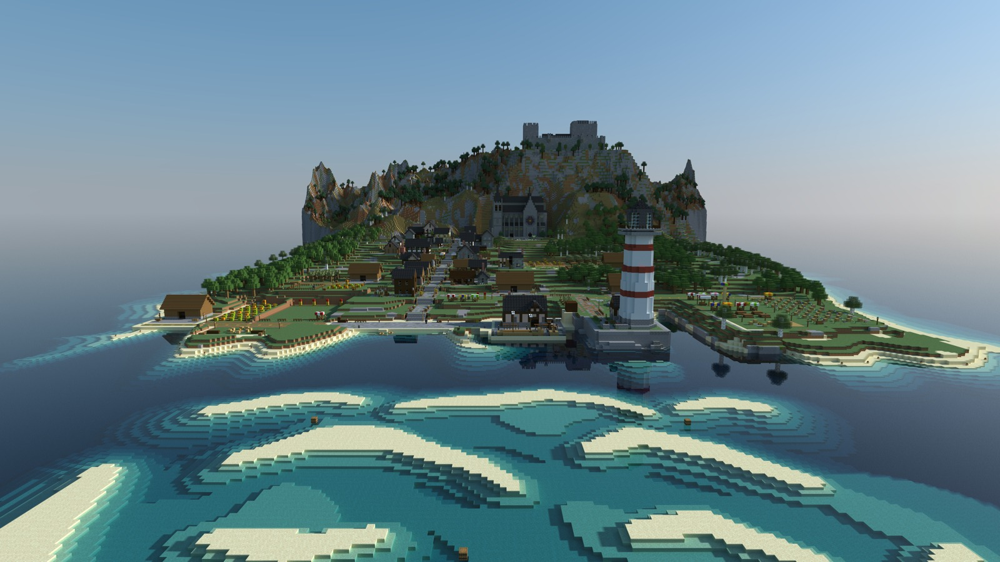
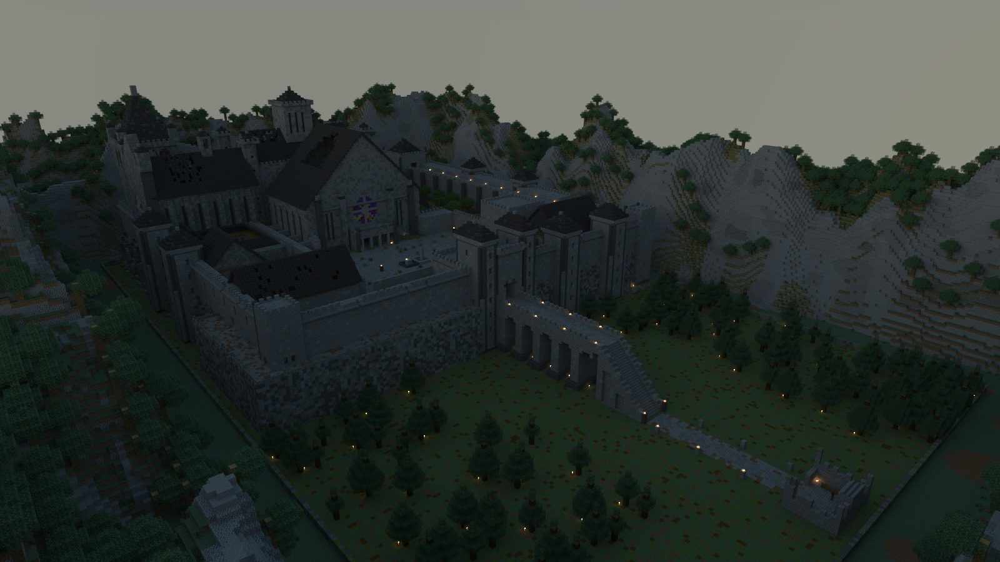
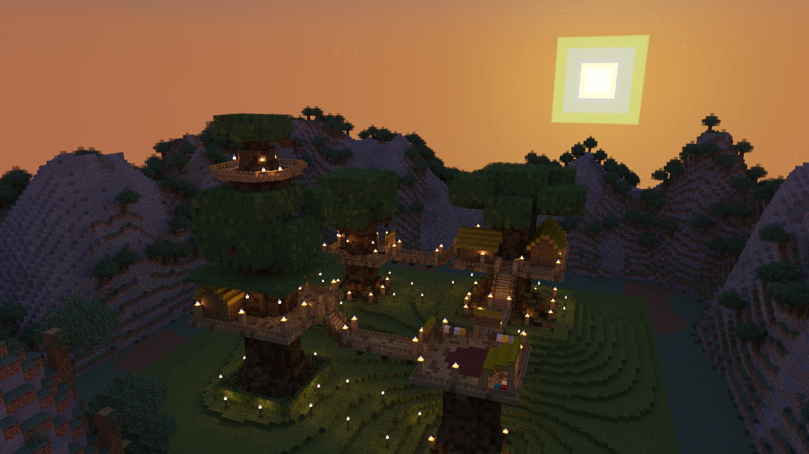
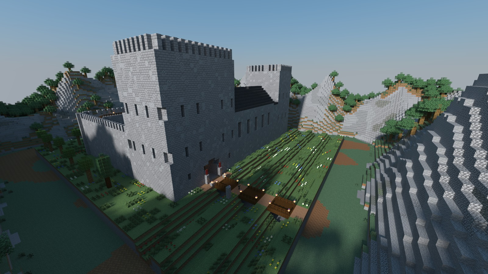

English · [简体中文](README.zh-CN.md)

# Campaigns built with Delvewright

Every delve here was built with Delvewright, and a bot played each one to the end before any player did. Click a title to walk through it in the order you play it (spoilers). To host one, run the command under it: `EULA=TRUE` says you accept the [Minecraft EULA](https://aka.ms/MinecraftEULA), and players join your machine's address from Minecraft Java 1.21.11. [Back to the front page](../../README.md).

## [Curtain Up in Kelderby](curtain-up-in-kelderby/README.md)

[](curtain-up-in-kelderby/README.md)

A cheerful day out for one to four players, about two and a half hours, with no combat. A stone-and-timber harbour town on the slope below a castle mountain: one main street stepping down from the cathedral square to the quays, side streets of houses and workshops, a lighthouse on the harbour wall, and a castle at the top of a long road. Four classes to choose from.

```sh
docker run -e EULA=TRUE -p 25565:25565 ghcr.io/stellarfeline/delve-foot-of-the-mountain:latest
```

## [Vesperhold](vesperhold/README.md)

[](vesperhold/README.md)

A souls-like castle for one to four hired blades, about an hour long. The bell of a Gothic hold on a crag has been silent for ten years, its gates are shut, and its guards keep a watch they no longer understand; you climb from a fire at the foot of the causeway to the throne, fighting all the way. Four classes to choose from.

```sh
docker run -e EULA=TRUE -p 25565:25565 ghcr.io/stellarfeline/delve-vesperhold:latest
```

## [The Treehouse Camp](the-treehouse-camp/README.md)

[](the-treehouse-camp/README.md)

A gentle walk and climb for one to four guests, under half an hour, with nothing hostile in it. A forest clan lives in houses built round four giant trees, joined by rope bridges and rope ladders; on Lantern Night you fetch a lantern and its oil from two houses, carry it up the tallest tree, and watch the whole camp light up below you.

```sh
docker run -e EULA=TRUE -p 25565:25565 ghcr.io/stellarfeline/delve-the-treehouse-camp:latest
```

## [Doune Castle: A Guided Tour](doune/README.md)

[](doune/README.md)

A walk through a real fourteenth-century Scottish castle with a guide who knows it, about thirty-five minutes, no combat. Nine stops from the gatehouse to the wall-walk, and you may wander off the tour from the first minute.

```sh
docker run -e EULA=TRUE -p 25565:25565 ghcr.io/stellarfeline/delve-doune-castle-tour:latest
```

---

These are renders of original content built by the engine, shown with Minecraft's textures, and shared under [Mojang's usage guidelines](https://www.minecraft.net/en-us/usage-guidelines) for screenshots.
