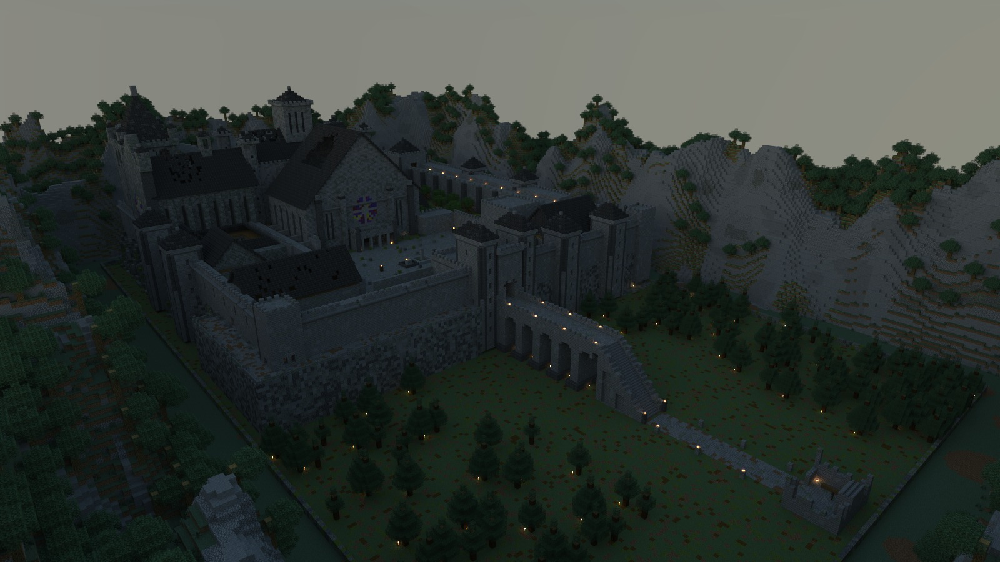
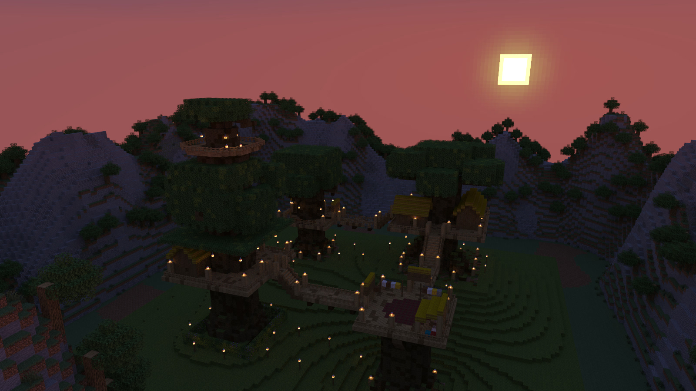
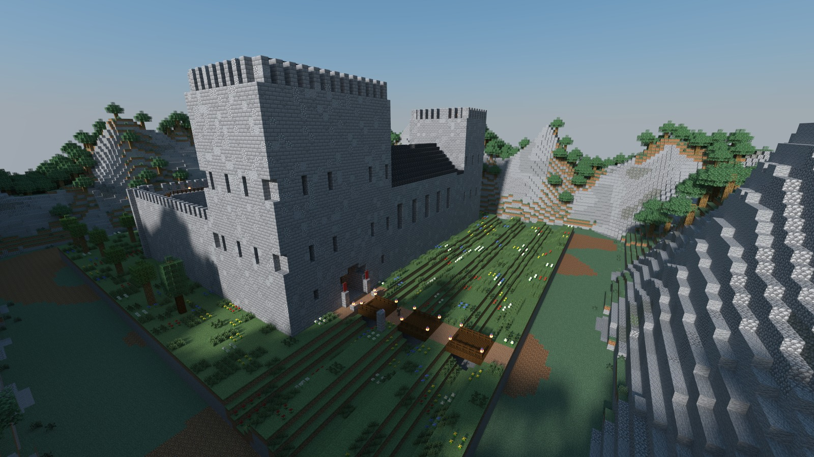

[English](README.md) · 简体中文

# 用 Delvewright 做出来的战役

这里的每一座 delve 都由 Delvewright 做成，在任何玩家进去之前，机器人已经把它从头玩到了结局。点开标题，按游戏内顺序走一遍（含剧透）。想自己开服，就运行它下面那行命令：`EULA=TRUE` 表示你同意 [Minecraft 最终用户许可协议](https://aka.ms/MinecraftEULA)，玩家用 Minecraft Java 1.21.11 连你这台机器的地址就能进。[回到首页](../../README.zh-CN.md)。

## [维斯珀堡（Vesperhold）](vesperhold/README.md)

[](vesperhold/README.md)

一座魂系城堡，留给一到四名受雇的刀剑，玩下来大约一小时。峭壁上这座哥特式要塞的钟已经十年没响，城门紧闭，守卫还在守望，却说不清自己守的是什么；你们从堤道脚下的一堆篝火出发，一路打上王座。四种职业可选。

```sh
docker run -e EULA=TRUE -p 25565:25565 ghcr.io/stellarfeline/delve-vesperhold:latest
```

## [树屋营地（The Treehouse Camp）](the-treehouse-camp/README.md)

[](the-treehouse-camp/README.md)

一场轻松的漫步加攀爬，一到四位客人，不到半小时，没有任何敌意。一个森林部族把家安在四棵巨树上，靠绳桥和绳梯来往；灯笼夜里，你们从两户人家那里分别取来灯笼和灯油，把它带上最高的那棵树，然后看着整个营地在脚下一盏盏亮起来。

```sh
docker run -e EULA=TRUE -p 25565:25565 ghcr.io/stellarfeline/delve-the-treehouse-camp:latest
```

## [杜恩城堡导览（Doune Castle: A Guided Tour）](doune/README.md)

[](doune/README.md)

跟着一位熟门熟路的向导，走一遍一座真实存在的十四世纪苏格兰城堡，大约三十五分钟，没有战斗。从城门楼到城墙步道一共九站，而且从第一分钟起，你就可以随时离开路线自己逛。

```sh
docker run -e EULA=TRUE -p 25565:25565 ghcr.io/stellarfeline/delve-doune-castle-tour:latest
```

---

这些是引擎建成的原创内容的渲染图，使用 Minecraft 的材质显示，依照 [Mojang 的使用准则](https://www.minecraft.net/en-us/usage-guidelines)中关于截图的规定分享。
