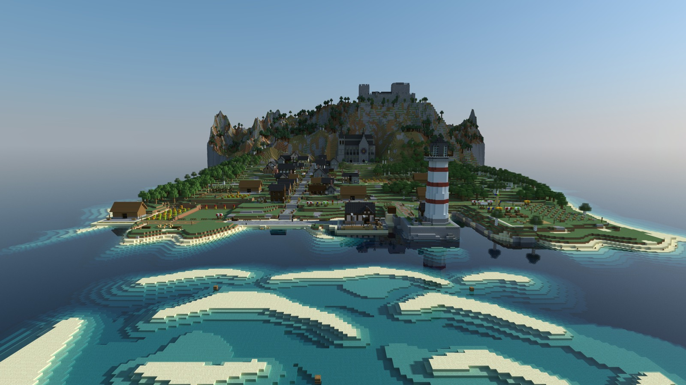
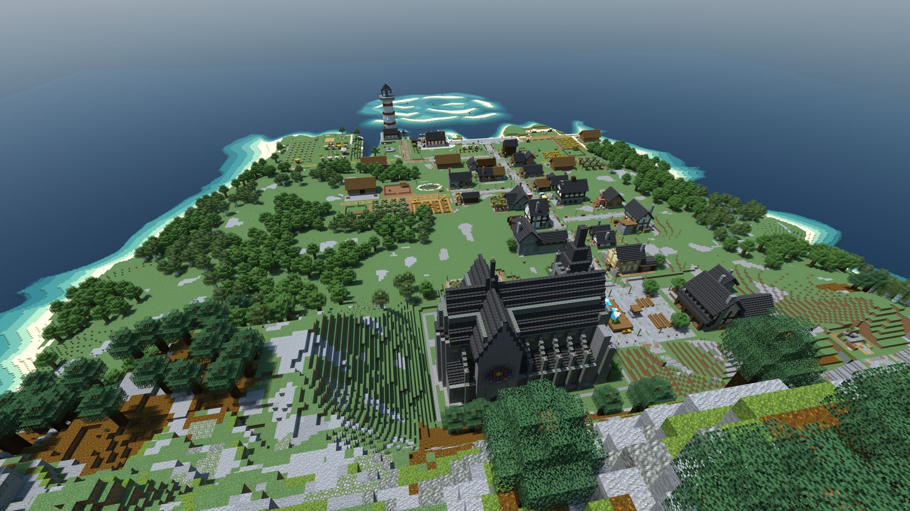
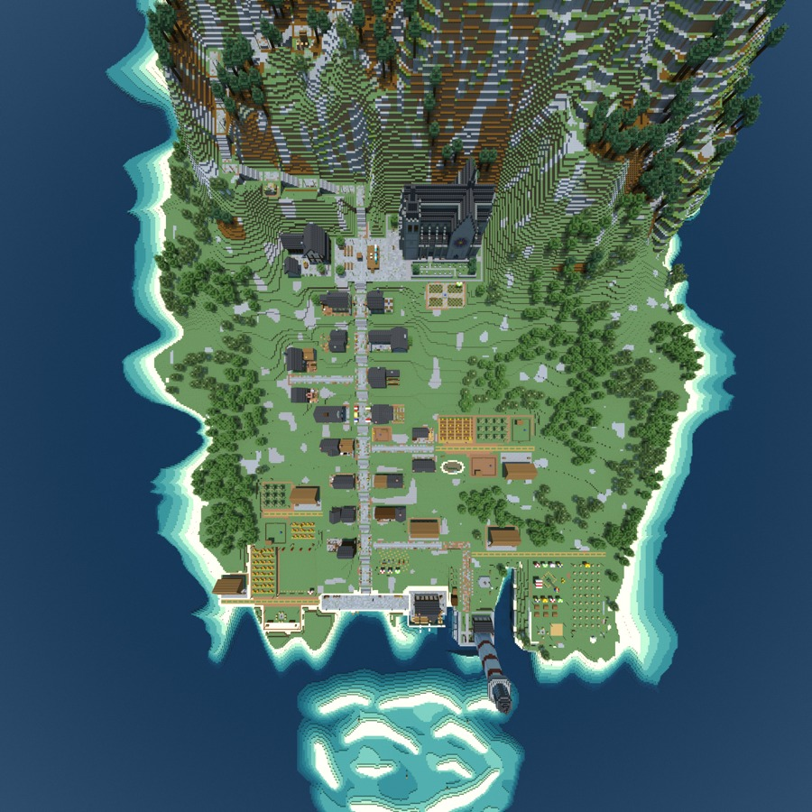
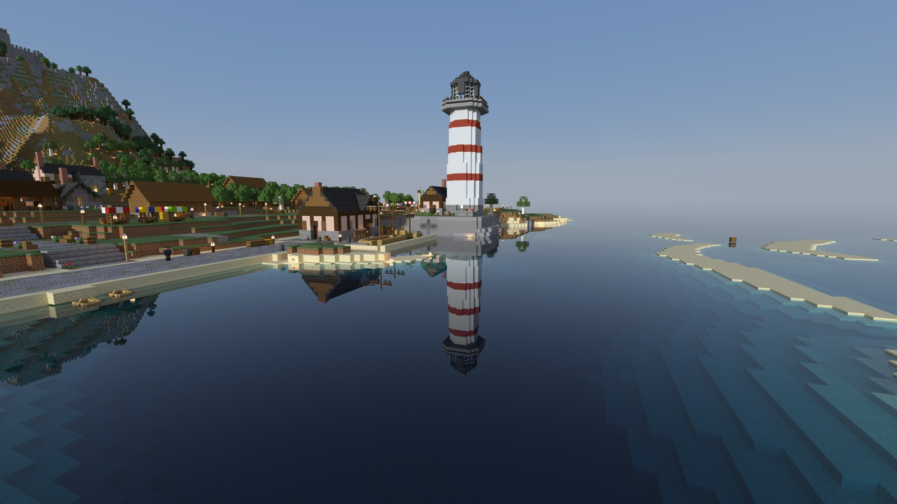
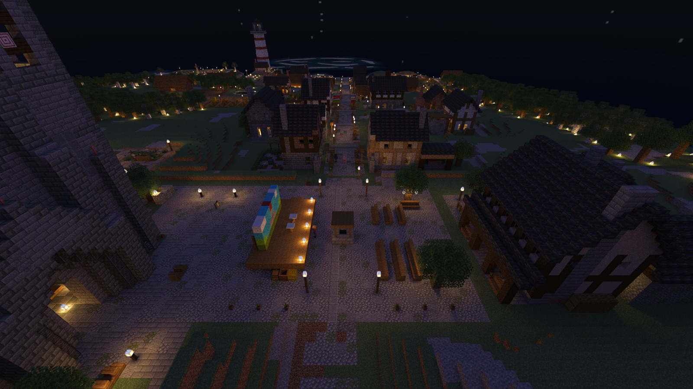

English · [简体中文](README.zh-CN.md)

# Inside Kelderby

Renders of **Curtain Up in Kelderby**, a delve built with Delvewright: a stone-and-timber harbour town on the slope below a castle mountain, seen through one day from morning to night. [All campaigns](../README.md) · [Back to the front page](../../../README.md).

The town from the sea in the early morning: pale sandbars and turquoise shallows offshore, the striped lighthouse on the quay, the main street climbing past the houses to the cathedral, and the castle on the summit of the mountain behind.

From the castle gate at mid-morning: the cathedral below the slope, the main street running down between the houses and the woods to the quay, the lighthouse, and the shallows out at sea.

The town straight from above at noon: the main street from the cathedral square to the harbour, the side streets, gardens and fields on either side, the woods along the shore, and the shallows off the quay.

The harbour toward evening from the water off the quay: the lighthouse mirrored in still water, the first lamps along the waterfront, and market awnings on the terraces above.

The cathedral square at night: the stage with its painted backdrop and a row of footlights, benches set out in front of it, lamp posts round the square, and the lamp-lit main street running down past lit windows to the lighthouse and the pale shallows beyond.

---

These are renders of original content built by the engine, shown with Minecraft's textures, and shared under [Mojang's usage guidelines](https://www.minecraft.net/en-us/usage-guidelines) for screenshots.
