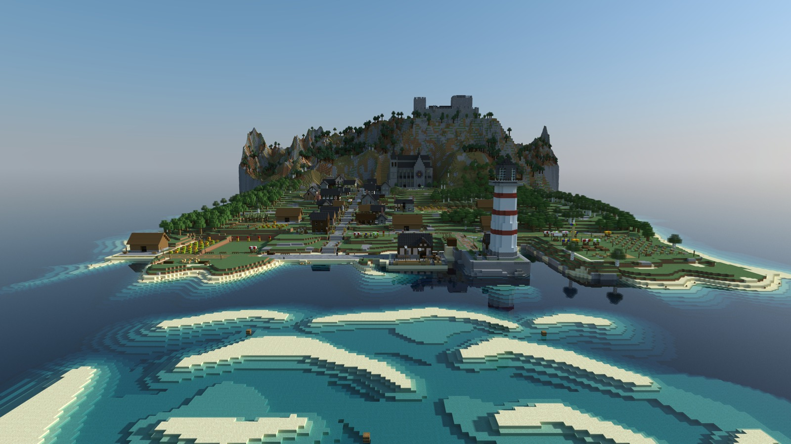
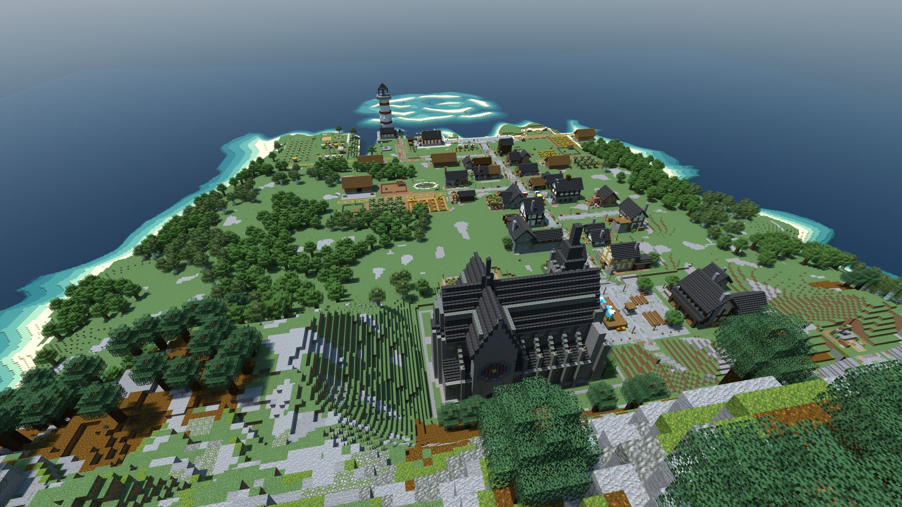
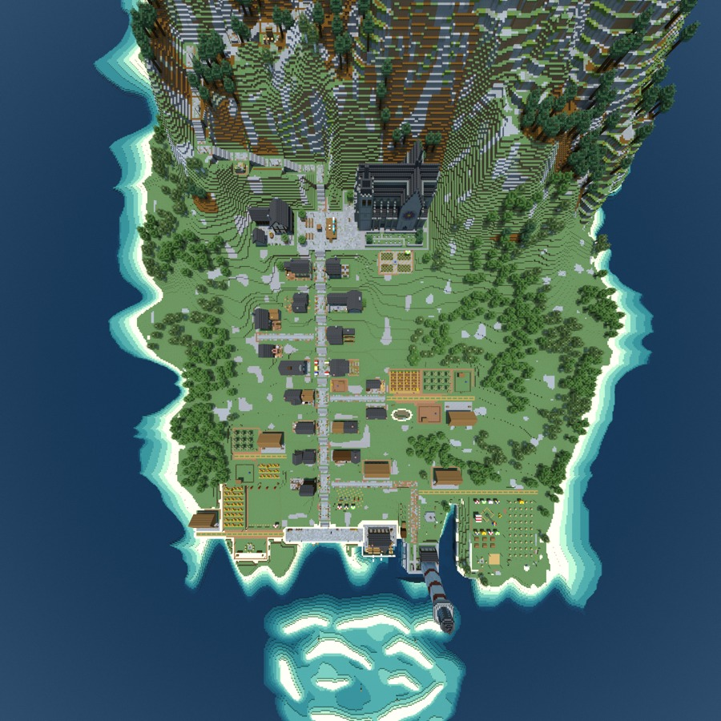
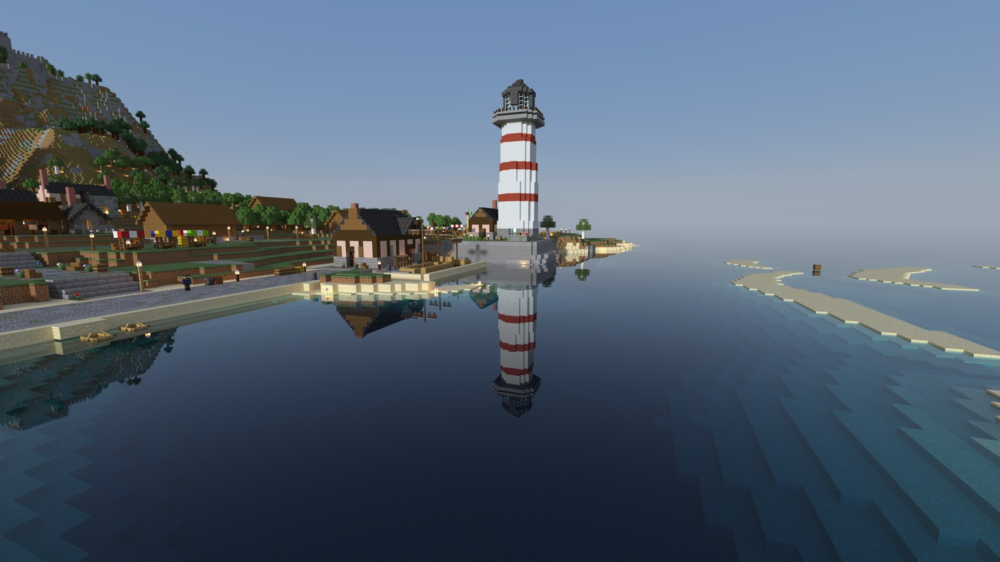
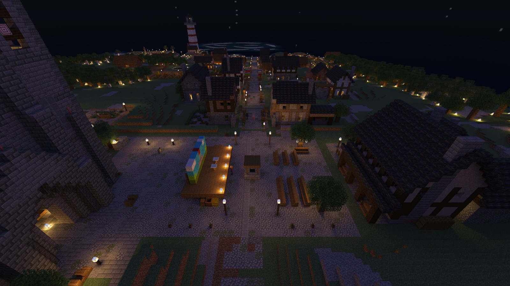

[English](README.md) · 简体中文

# 走进凯尔德比

**凯尔德比大幕拉开**的渲染图，这是一座用 Delvewright 做出来的 delve：城堡山下的山坡上，一座石头和木头搭起来的海港小镇，从早到晚走过一整天。[全部战役](../README.zh-CN.md) · [回到首页](../../../README.zh-CN.md)。

清晨，从海上看小镇：近处是浅色的沙洲和碧绿的浅滩，码头上立着红白条纹的灯塔，主街从一排排房子之间爬上去，一直到大教堂，后面的山顶上是城堡。

上午，站在城堡门口往下看：山坡下面是大教堂，主街穿过房子和树林，一路通到码头，再远是灯塔，海上是那片浅滩。

正午，从正上方俯瞰小镇：主街从大教堂广场通到港口，两旁是小巷、菜园和田地，海岸边是树林，码头外是浅滩。

快到傍晚，从码头外的水面上看港口：平静的水面映出灯塔的倒影，岸边的灯已经亮了起来，上面一层层台地上搭着集市的彩色棚子。

夜里的大教堂广场：舞台上立着彩绘的布景，台口一排脚灯，台前摆好了长椅，广场四周立着路灯；亮着灯的主街一路往下，经过一扇扇亮着的窗，通到灯塔和远处泛白的浅滩。

---

这些是引擎建成的原创内容的渲染图，使用 Minecraft 的材质显示，依照 [Mojang 的使用准则](https://www.minecraft.net/en-us/usage-guidelines)中关于截图的规定分享。
